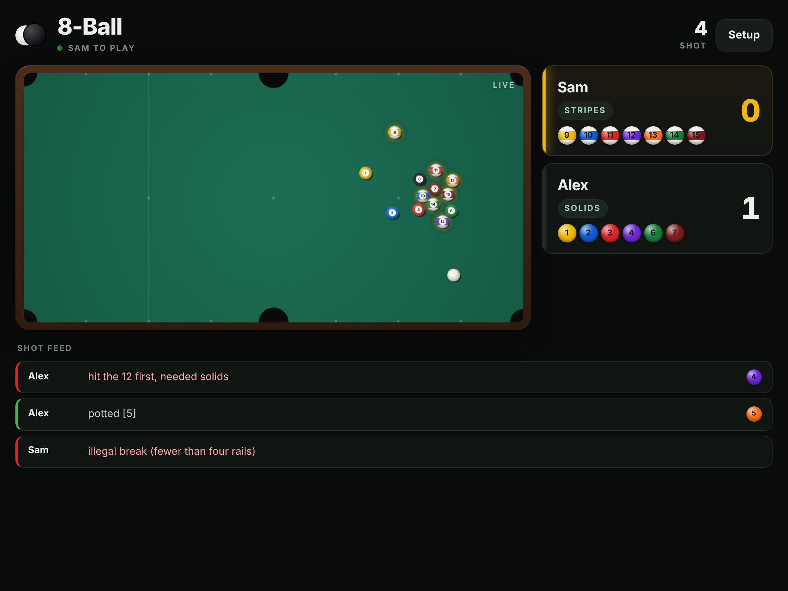

# Pool Arena

Camera scoring and projected games for a real pool table.

One overhead camera watches the table, works out what happened on each shot,
and a projector draws the consequences back onto the cloth — pockets flare
when a ball drops, aiming lines appear for practice modes, and whole game modes
exist that could not work without light on the table.

**It runs with no hardware.** A built-in simulator drives the entire stack, so
you can see every animation and play every game mode before you mount anything.

```bash
git clone <your-remote> pool-arena && cd pool-arena
pip install numpy
python -m poolarena demo
```

Then open <http://localhost:8777/> for the projector view and
<http://localhost:8777/scoreboard.html> for the tablet.


The tablet on the rail shows the live table, the roster as actual balls, and a
colour-coded shot feed:



## What works today

- **Scoring** for 8-ball, 9-ball, cut-throat and killer, with fouls: wrong ball
  first, scratch, no rail after contact, 8 early, illegal break.
- **Three projection-native game modes** — Hotspots, Pocket Roulette and a
  graded Position Drill — that only make sense on a table with a projector.
- **26 projected effects**: pocket flares, explosions, ball trails, ghost-ball
  aiming lines with the tangent line and cut angle, glowing zones, fireworks,
  lightning, on-cloth banners.
- **Four-corner keystone calibration** in the browser, so the projector does
  not have to be square to the table.
- **A tablet scoreboard** with a live top-down table view, drawn from the same
  state stream, that works from a phone up to a wall display.
- **A simulator** good enough to develop and demo the whole system without a
  camera, a projector or a table.
- **44 tests** covering geometry, shot detection, every rule set and the full
  pipeline end to end.

## What doesn't, yet

- The colour detector is written and reasonable but **has not been tuned
  against a real table** — that needs your cloth, your lights and your camera.
  Expect to spend an evening on `config/detector.json`.
- Live cue-stick tracking (the "draw the line I'm actually on" feature) is
  designed for but not built.
- No audio.

## Commands

```bash
python -m poolarena demo                        # simulated table, no hardware
python -m poolarena demo --game hotspots --players "Sam, Alex"
python -m poolarena calibrate --source kinect   # click the four cushion corners
python -m poolarena run --source kinect --game 8ball
python -m poolarena run --source cam:0 --learn-cloth
python -m poolarena games                       # list game modes
python -m poolarena effects                     # list projector effects
python -m poolarena replay shots.jsonl          # re-run a logged session
```

Overlay keys: `c` calibration, `b` draw tracked balls, `f` fullscreen,
`t` trails, `o` clipping, `x`/`g` test effects, `h` help.

## Hardware

An overhead camera, a PC, a short-throw projector on the ceiling. A Kinect v2
works well: its 1080p colour stream is plenty, and its depth stream — useless
for resolving balls — is ideal for spotting an arm over the cloth.

Scoring reads the table when it is **still**, so 30 fps is plenty and nothing
needs to be fast. See [docs/HARDWARE.md](docs/HARDWARE.md) for mounting, USB
pitfalls, lighting, and why the projector's own keystone correction should stay
off.

## How it fits together

```
  camera ──► vision ──────► events ──────► rules ──────► overlay
             (pixels)       (shots)       (verdicts)     (light)
                 │              │             │              ▲
                 └──────────────┴─────────────┴──────────────┘
                        everything speaks table millimetres
```

Vision is the only layer that imports OpenCV. Everything above it — shot
detection, every game, every animation — runs and is tested without a camera
installed. A new game is one file and one method; it never sees a pixel.

Read [docs/ARCHITECTURE.md](docs/ARCHITECTURE.md) for the reasoning, including
why first contact is inferred from motion onset rather than proximity (at 30 fps
a ball moves 100 mm between frames, so a "were they touching?" test simply
misses collisions).

## Docs

- [Architecture](docs/ARCHITECTURE.md) — the layers and the decisions behind them
- [Hardware](docs/HARDWARE.md) — cameras, the Kinect, PC specs, projector, lighting
- [Calibration](docs/CALIBRATION.md) — the two homographies, and how to check them
- [Games](docs/GAMES.md) — the rule sets, their options, and how to write one
- [Projection ideas](docs/PROJECTION_IDEAS.md) — the backlog of things worth projecting

## Prior art

- [pooltool](https://github.com/ekiefl/pooltool) — proper billiards physics.
  Use it if you need real simulation; `poolarena/sim` is deliberately crude.
- [Fergus-Gault/Pool-Ball-Tracker](https://github.com/Fergus-Gault/Pool-Ball-Tracker)
  — YOLO tracking with obstruction handling.
- [Rainbowman0/YOLOv5-BilliardsDetection](https://github.com/Rainbowman0/YOLOv5-BilliardsDetection)
  — training data for American pool balls, which would save labelling work if
  you switch the detector to YOLO.

## Tests

```bash
python -m pytest tests/ -q
```

## Licence

MIT.
