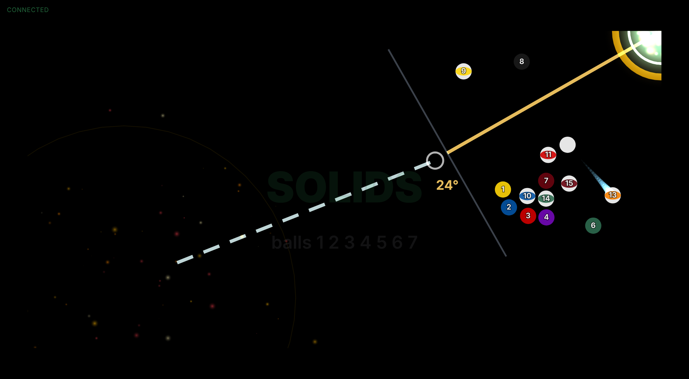

# Pool Arena

Camera scoring and projected games for a real pool table.

One overhead camera watches the table, works out what happened on each shot,
and a projector draws the consequences back onto the cloth — pockets flare
when a ball drops, aiming lines appear for practice modes, and whole game modes
exist that could not work without light on the table.

**It runs with no hardware.** A built-in simulator drives the entire stack, so
you can see every animation and play every game mode before you mount anything.

```bash
git clone <your-remote> pool-arena && cd pool-arena
pip install numpy
python -m poolarena demo
```

Then open <http://localhost:8777/> for the projector view and
<http://localhost:8777/scoreboard.html> for the tablet.



Leave it alone and it plays a ghost game of pool with itself until someone
racks up:


The tablet on the rail shows the live table, the roster as actual balls, and a
colour-coded shot feed:


## What works today

- **Scoring** for 8-ball, 9-ball, cut-throat, killer and both UK codes —
  English 8-Ball (two shots after a foul) and Blackball (free shot) — with
  fouls: wrong ball first, scratch, no rail after contact, black early,
  potting the opponent's ball, illegal break.
- **Three projection-native game modes** — Hotspots, Pocket Roulette and a
  graded Position Drill — that only make sense on a table with a projector.
- **26 projected effects**: pocket flares, explosions, ball trails, ghost-ball
  aiming lines with the tangent line and cut angle, glowing zones, fireworks,
  lightning, on-cloth banners.
- **Both calibrations in the UI, no terminal.** Setup → Camera finds the
  camera, takes a picture and takes four taps to learn where the table is;
  Setup → Projector nudges the projected outline onto the cushions. Works on
  a PC touchscreen, a tablet or a phone.
- **A tablet scoreboard** with a live top-down table view, drawn from the same
  state stream, that works from a phone up to a wall display — including a
  calibration pad that drives the projector, so you align it standing at the
  table rather than at the PC.
- **Both ball sets**: American numbered 1-15, or English reds and yellows
  (`--ball-set english`). Games that genuinely need numbered balls are refused
  on an English set rather than scored by guesswork.
- **A simulator** good enough to develop and demo the whole system without a
  camera, a projector or a table.
- **Undo, redo and manual score correction.** Undo is in the top bar, not
  buried in settings — it rewinds whose turn it is, group assignment, UK
  visits and a frame the table wrongly called as won. Per-player +/- buttons
  cover the other half: undo restores the old score, but only you know the
  right one.
- **A palette computed for your cloth.** A projector's light is multiplied by
  what the cloth reflects, so red is nearly invisible on green and fine on
  pale blue. Set `cloth` in `config/table.json` (or `--cloth "#8FB7D9"`) and
  the overlay picks a palette measured against that surface.
- **An attract mode.** Leave the table alone and it starts playing a ghost
  game of pool with itself, captioned with how to begin and what games it
  knows. A ball moving — or an arm over the cloth — clears it instantly.
- **A detector installer in the UI.** Setup → Detector installs YOLO support
  and takes a trained model from a link or a file, then tests it on a real
  camera frame. You do not need a GPU: detection runs once per shot on a
  still table. It says plainly that a `.pt` file runs code when loaded.
- **One camera or several.** A second camera is an option, not a rewrite:
  each keeps its own calibration and the views are fused in table
  millimetres. It buys seeing past a player leaning over the cloth, not
  better numbers — see [docs/HARDWARE.md](docs/HARDWARE.md) for which
  combination is worth buying and which to avoid.
- **Scoring without a projector.** `--no-projector` and the guides that
  would have been on the cloth — live zones, the nominated pocket, aiming
  lines — are drawn on the scoreboard's table view instead, so the
  projection-native games stay playable.
- **Depth-based ball finding** (`--depth-balls`). A Kinect's depth stream
  has no illumination term at all, so shadows, glare and cloth colour cannot
  affect it: depth says where the balls are, colour says which ball each one
  is. Found every ball on synthetic frames at noise several times worse than
  the real sensor.
- **Calibration from printed markers.** Four ArUco markers taped to the
  cloth calibrate the camera to about 1 mm — better than a careful human
  click and far better than a typical one — and if you leave them up, a
  camera that gets knocked re-calibrates itself.
- **165 tests** covering geometry, shot detection, every rule set and the full
  pipeline end to end.

## What doesn't, yet

- The colour detector is written and reasonable but **has not been tuned
  against a real table** — that needs your cloth, your lights and your camera.
  Expect to spend an evening on `config/detector.json`.
- **No cue-ball-in-hand placement.** After a scratch the engine says "ball in
  hand"; nothing enforces where the cue ball is put back.
- **UK rules vary by league.** The two published codes are implemented and
  their differences are options, but your pub may play something else; see
  [docs/GAMES.md](docs/GAMES.md).
- Live cue-stick tracking (the "draw the line I'm actually on" feature) is
  designed for but not built.
- No audio.

## When the table gets a shot wrong

It will, especially before the detector is tuned. Two controls, both in the
scoreboard page:

- **Undo** (top bar) takes back the last judged shot. It rewinds the whole
  game state — the score, whose turn it is, which group each player owns, UK
  two-visit state, and a frame that was wrongly called as won. Press it
  repeatedly to go further back. **Redo** appears if you overshoot.
- **+ / −** on each player card sets a score by hand. Undo puts the old score
  back but cannot know what the right one was; this is the override for when
  the camera called it and the answer is simply a different number.

Undo rewinds the *score*, not the table. The balls stay where they physically
are, so the next real shot is judged from the current layout — which is what
you want when the system got one wrong and play has moved on.

## Commands

```bash
python -m poolarena demo                        # simulated table, no hardware
python -m poolarena demo --game hotspots --players "Sam, Alex"
python -m poolarena calibrate --source kinect   # click the four cushion corners
python -m poolarena run --source kinect --game 8ball
python -m poolarena run --source cam:0 --learn-cloth
python -m poolarena games                       # list game modes
python -m poolarena effects                     # list projector effects
python -m poolarena replay shots.jsonl          # re-run a logged session
```

Overlay keys: `c` calibration, `b` draw tracked balls, `f` fullscreen,
`t` trails, `o` clipping, `x`/`g` test effects, `h` help.

## Hardware

**If a light hangs over your table, read
[docs/HARDWARE.md](docs/HARDWARE.md) before buying anything.** A traditional
pool light shadows about 84% of the table's length from a ceiling camera, so
a single overhead camera is not viable while it is there, and it blocks the
projector too.


An overhead camera, a PC, a short-throw projector on the ceiling. A Kinect v2
works well: its 1080p colour stream is plenty, and its depth stream — useless
for resolving balls — is ideal for spotting an arm over the cloth.

Scoring reads the table when it is **still**, so 30 fps is plenty and nothing
needs to be fast. See [docs/HARDWARE.md](docs/HARDWARE.md) for mounting, USB
pitfalls, lighting, and why the projector's own keystone correction should stay
off.

## How it fits together

```
  camera ──► vision ──────► events ──────► rules ──────► overlay
             (pixels)       (shots)       (verdicts)     (light)
                 │              │             │              ▲
                 └──────────────┴─────────────┴──────────────┘
                        everything speaks table millimetres
```

Vision is the only layer that imports OpenCV. Everything above it — shot
detection, every game, every animation — runs and is tested without a camera
installed. A new game is one file and one method; it never sees a pixel.

Read [docs/ARCHITECTURE.md](docs/ARCHITECTURE.md) for the reasoning, including
why first contact is inferred from motion onset rather than proximity (at 30 fps
a ball moves 100 mm between frames, so a "were they touching?" test simply
misses collisions).

## Docs

- **[Setting it up](docs/SETUP.md)** — start here: requirements, camera
  options, and the five things that actually affect accuracy

- [Architecture](docs/ARCHITECTURE.md) — the layers and the decisions behind them
- [Hardware](docs/HARDWARE.md) — cameras, the Kinect, PC specs, projector, lighting
- [Calibration](docs/CALIBRATION.md) — the two homographies, and how to check them
- [Games](docs/GAMES.md) — the rule sets, their options, and how to write one
- [Projection ideas](docs/PROJECTION_IDEAS.md) — the backlog of things worth projecting

## Prior art

- [pooltool](https://github.com/ekiefl/pooltool) — proper billiards physics.
  Use it if you need real simulation; `poolarena/sim` is deliberately crude.
- [Fergus-Gault/Pool-Ball-Tracker](https://github.com/Fergus-Gault/Pool-Ball-Tracker)
  — YOLO tracking with obstruction handling.
- [Rainbowman0/YOLOv5-BilliardsDetection](https://github.com/Rainbowman0/YOLOv5-BilliardsDetection)
  — training data for American pool balls, which would save labelling work if
  you switch the detector to YOLO.

## Tests

```bash
python -m pytest tests/ -q
```

## Licence

MIT.
