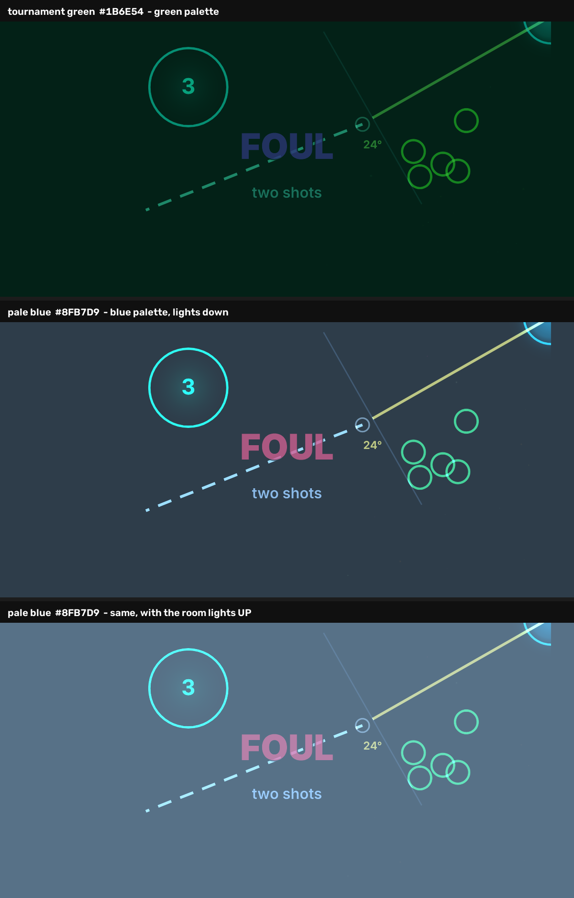

# Hardware

## The short version

An overhead colour camera, a PC that can run Python, and a short-throw
projector on the ceiling. Nothing exotic, and nothing that has to be fast:
scoring reads the table when it is *still*, so 30 fps is plenty.

## Camera

Pool is an easier vision problem than darts. A dart tip is small, occluded and
needs depth, which is why Autodarts uses three cameras 120° apart. A pool table
is a flat, fixed, high-contrast plane, so one overhead camera does the job.

| | Minimum | Comfortable |
|---|---|---|
| Resolution | 1080p | 1080p–4K |
| Frame rate | 30 fps | 60 fps+ (needed only for live cue tracking) |
| Shutter | rolling | global, if you want clean mid-shot frames |
| Mount height | 2.0 m above the cloth | 2.2–2.5 m |
| Lens | wide enough to see all four corners | same, with a little margin |

Mount it over the **centre** of the table, looking straight down if you can.
Off-centre is fine — the homography handles it — but the further off-axis, the
more the far corner's balls occlude each other.

### Can the camera go at the side of the table?

Yes, if it is high enough — and a detector has nothing to do with it. This is
geometry, and no model can see a ball that is behind another ball.

Two things get worse as the camera comes down from overhead. One is
**occlusion**, which is the hard limit, and the worst case is the rack,
which happens at the start of every single game. Measured on a tight
15-ball triangle on a 7ft/8ft English table:

| Camera | Balls hidden in the rack |
|---|---|
| Overhead, 2.2–3.0 m above the centre | **0 of 15** |
| Long side, 2.2 m up, 1 m out | **0 of 15** |
| Long side, 1.5 m up, 1 m out | 10 of 15 |
| Long side, 1.0 m up, 1 m out | 10 of 15 |
| End on, 1.5 m up, 1 m back | 14 of 15 |

A hidden ball is indistinguishable from a potted one. The shot detector
refuses to score rather than score fiction, so a low mount does not produce
wrong scores — it produces a table that will not score at all.

The other is **parallax**: the ball's centre sits one radius above the cloth,
so the camera sees it displaced outward from the point beneath the lens.

| Camera | Worst error, uncorrected | Corrected |
|---|---|---|
| Overhead, 2.2 m | 13 mm | **0.0 mm** |
| Long side, 2.2 m up, 1 m out | 26 mm | **0.0 mm** |
| Long side, 1.8 m up, 1 m out | 32 mm | **0.0 mm** |
| Long side, 2.2 m up, nadir left at table centre | 26 mm | 18 mm |

The correction is exact, because the model is exact — similar triangles and
nothing else. But it is **off by default**, and off a side mount it is the
difference between working and not: 26 mm against a 70 mm pocket capture
radius will put a hanging ball on the wrong side of the jaws.

Turn it on by telling it the height and the point on the table directly
beneath the lens. For a camera 2.2 m up and 1 m out from the long side of an
8ft table, that point is outside the cushion, which is fine:

```
run --camera-height 2200 --camera-nadir "1117,-1000"
```

Get the nadir wrong and most of the benefit goes with it — leaving it at the
table centre recovers only 26 mm → 18 mm. It is worth measuring.

**So: overhead if you can, a high side mount if you cannot, and never low or
end-on.** The reason to prefer overhead is not accuracy — the corrected
numbers are identical — it is that overhead is forgiving of everything else.

### Kinect v2 (Xbox One sensor)

What you have, and it works:

- **Colour:** 1920×1080 at 30 fps, wide field of view. At ~2 m over an 8 ft
  table a ball is about 35 px across, which is comfortable.
- **Depth:** 512×424. Far too coarse to resolve balls (a ball is ~7 px), so
  this code never tries. Depth is used for one thing only, and it is a good
  thing: telling whether an arm, a cue or a body is over the cloth, which is
  exactly when colour detection should be ignored. See
  `VisionPipeline._depth_obstructed`.
- **Frame rate warning:** the Kinect's auto-exposure drops the colour stream to
  ~15 fps in dim light. Light the table properly or you will lose shots.

**USB is the fussy part.** Kinect v2 needs:

- a genuine USB 3.0 port, no hub;
- an Intel or Renesas controller. ASMedia controllers are a known source of
  dropouts. If your motherboard has one, a £15 PCIe card with a Renesas chip
  fixes it;
- its own power brick and the official USB adapter;
- a short cable run. Most powered USB 3 extenders do *not* work with it. If the
  sensor is on the ceiling and the PC is not, test the extender before you
  mount anything.

**Drivers:**

- Windows: Kinect for Windows SDK 2.0, then `pip install pykinect2`.
- Linux/macOS: build [libfreenect2](https://github.com/OpenKinect/libfreenect2)
  with OpenCL or CUDA support, then `pip install pylibfreenect2`.

`KinectV2Source` picks whichever it finds.

**Does it find the Kinect on its own?** Yes, once a driver is installed.
`--source auto` (the default for `run` and `calibrate`) tries a Kinect v2
first and falls back to the first webcam that opens, and **Setup → Camera →
Connect camera** does the same from the UI. What it cannot do is install the
driver for you: with no `pykinect2` or `pylibfreenect2` present, the sensor is
invisible to Python no matter how it is plugged in. The Camera tab says so
explicitly rather than just reporting "no camera".

**Kinect v1 (Xbox 360): don't.** At 640×480 a ball is about 14 px across.

### Reds and yellows are easier to see than a numbered set

If you have a UK blackball set, the vision problem gets markedly simpler: two
well-separated hues plus a black and a white, instead of seven hues that have
to be told apart *and* a stripe-versus-glare judgement on every ball. Run with
`--ball-set english` and the detector switches models.

The trade is that no camera can tell one red from another — so 9-ball and
cut-throat are unavailable, by design, rather than being scored by guesswork.

## If a light hangs over your table

This is the common case and it changes the answer to everything below, so
read it first.

A traditional pool light sits about 0.8–0.9 m over the cloth, centred, and
roughly a metre and a half long. It is exactly where a ceiling camera and a
ceiling projector both want to be. From a camera at 2.2 m, that fixture
casts a shadow across **84% of the table's length**; at 3 m it is still 77%.
A single centred overhead camera is therefore not an option while the light
is there — not "degraded", not viable.

Three ways out, best first.

### 1. Replace the light (recommended)

Take the fixture down and light the table from the sides: diffused LED
strips along the long rails, or bounced off a pale ceiling. This is already
what the camera wants for other reasons — it kills the specular highlight on
every ball that reads like a cue ball, and it removes the hot-centre,
dark-corners gradient. It also frees the middle of the ceiling for both the
camera and the projector, which is the only arrangement where everything is
easy.

If you are going to spend money anywhere on this project, spend it here
rather than on a second camera.

### 2. Keep the light, use two cameras off to the sides

This is the case where a second camera stops being a luxury. Mount one past
each long rail — or past opposite corners — so neither looks through the
fixture, and let the fusion combine them. Every ball then sits within about
1.5 m of a camera.

Two things get harder, and both have answers:

- **Parallax roughly doubles.** It grows with distance from the point under
  the lens, so moving off-axis makes it worse: 14.5 mm worst-case from a
  centred mount at 2.5 m, 28.9 mm from a corner mount. It is a systematic
  bias rather than noise, so **correction stops being optional** — set
  `height_mm` for each camera.
- **The nadir can no longer be guessed.** With a straight-down camera the
  software estimates the point beneath the lens from the image centre. A
  tilted off-axis camera aims somewhere other than straight down, so that
  guess can be a metre wrong, and a parallax correction that pulls towards
  the wrong point is worse than none. Measure it with a plumb line from the
  lens and set `nadir` per camera in `config/cameras.json`. It may well fall
  outside the table — negative, or beyond the length — which is fine.

### 3. Keep the light, mount cameras on the fixture itself

Clamp two or three small cameras along the light bar looking straight down.
They are already centred, nothing occludes them, and the fusion handles the
overlap. The trade is a very wide lens at 0.8 m, heavy distortion at the
edges, large parallax (correctable — you know the height precisely), and
lamps sitting right beside the lens, so shield them.

### Depth: the one thing shadows cannot touch

If you have a Kinect v2 and a badly lit table, this is the reason to keep it.

Colour detection fails in exactly the ways a pool room fails — a lamp's hot
centre, a player's shadow, glare on a ball, cloth that is nearly the colour
of a green ball. **Depth fails in none of them.** There is no illumination
term in a depth map at all: a shadow has no depth, glare has no depth, and
the cloth's colour is irrelevant. A ball is simply 57 mm of "closer to the
sensor than the cloth is", in the dark as much as in daylight.

The resolution is enough. A Kinect v2's depth stream is 512x424, which at
2.2 m is about 6 mm per pixel — a ball is ~9 px across, around 70 pixels to
work with, standing 57 mm proud against a few mm of sensor noise. On
synthetic frames every ball is found at noise levels up to 10 mm, which is
several times worse than the real sensor.

What depth cannot do is tell a red from a yellow or a 3 from an 11. So the
division of labour is:

> **depth says where the balls are, colour says which ball each one is.**

Run it with `--depth-balls`. The depth camera needs its own calibration
(`config/calibration-depth.json`) because its optics differ from the colour
camera's — calibrate it the same way, clicking the cushion corners, and the
two meet in table millimetres rather than being registered pixel to pixel.

When colour loses balls to a shadow, those balls still appear, marked as
located-but-unidentified rather than vanishing. For scoring that is usually
enough: the system knows something is there, so it does not score a shadowed
ball as potted.

### Shadows on the cloth, and what a YOLO model does about them

Two different shadow problems get confused, and only one of them is a vision
problem at all.

**Projector shadows are not fixable by any detector.** The projector is an
output. A player leaning over the table blocks light that then never reaches
the cloth, and no model — YOLO or otherwise — can recover light that was not
emitted. The only remedies are physical: mount the projector higher, use two
from opposite corners, or accept it.

**Camera-side shadows are a vision problem**, and the detector already deals
with most of them. A shadow changes how much light fell on the cloth and
barely touches its colour, so the cloth model compares each pixel against
its surroundings **in chroma only**, throwing lightness away. Measured on a
synthetic frame with a hard-edged shadow across half the table, comparing
full Lab distance found 4 balls out of 8; comparing chroma finds 7 or 8.

A trained YOLO model would be more robust still — it learns what a ball
looks like rather than thresholding colour, so shading bothers it far less —
but on shadows specifically the gap is smaller than it used to be, and it
costs a few gigabytes of PyTorch to close. Tune the colour detector first.

### The projector has the same problem

A hanging light blocks a ceiling projector exactly as it blocks a camera.
The four-corner keystone means the projector does **not** have to be square
to the table, so mounting it off to one side works — but the fixture will
throw a hard shadow across the cloth from any angled position, and no
software fixes that. Two projectors from opposite corners cancel most of it.
Taking the light down remains the clean answer.

## Would two cameras be better?

Yes — but probably not for the reason you expect, and one of the obvious
combinations is a trap.

**What a second camera actually buys**, in order of how much it helps:

1. **Seeing past people.** One overhead camera is blocked every time a
   player leans across the cloth. With two, something usually still sees
   each ball, and the table only counts as obstructed when *every* camera is
   blocked. In a test with a body blocking one view of the far end, the
   blocked camera found 6 of 8 balls on its own and the pair found 8.
2. **Glare.** A specular highlight that ruins a ball in one view is rarely
   in the same place in the other.
3. **Coverage.** On a 9 ft table under a low ceiling, one camera may not see
   all four corners, or balls at the far end are too few pixels across. Two
   cameras over opposite halves roughly double the pixels on a ball.
4. **Accuracy** — real, but the smallest of the four, and the cheapest to
   get another way. Most of the position error a single camera has at the
   far end is parallax, which is geometry (see below).

So: add a second camera to see past people and around glare, not to make the
numbers better.

### Which combination

| | verdict |
|---|---|
| **2 × HD webcams** | **best value.** Cheap, high resolution, no USB bandwidth drama, and each can be placed purely for coverage — which matters most if a hanging light forces them off to the sides. |
| **1 × Kinect v2 + 1 × HD webcam** | **good, and better than it looks.** The Kinect's depth both answers "is an arm over the cloth?" and finds the balls themselves without caring about light at all (see below); the webcam gives a higher-resolution colour view to name them. Under a hanging lamp, with shadows, this is the strongest pairing. |
| **2 × Kinect v2** | **avoid.** Each one wants its own USB 3 host controller — two on the same controller will not run — and they flood the bus. Their active infrared also illuminates the same scene, so the two depth streams interfere. All that for depth you do not need twice. |

### Setting it up

One camera stays the default and needs no configuration. For two:

```bash
python -m poolarena calibrate --source kinect --calibration config/calibration-head.json
```

```bash
python -m poolarena calibrate --source cam:1 --calibration config/calibration-foot.json
```

```bash
python -m poolarena run --source "kinect,cam:1"
```

Or copy `config/cameras.json.example` to `config/cameras.json` and list them
there, which also lets you set each camera's height. The cameras do not have
to match, be aligned, or be the same kind: each keeps its own calibration and
everything is fused in table millimetres, not in pixels.

## Parallax: the error a second camera is often bought to fix

A ball is a 57 mm sphere, so the detector finds a centre sitting 28.6 mm
**above** the cloth — while the calibration maps the cloth itself. A ball
away from the point directly under the camera is therefore reported further
out than it really is:

| camera height | error at mid-table | error in the far corner of an 8 ft table |
|---|---|---|
| 1.8 m | 9.7 mm | 20.2 mm |
| 2.2 m | 7.9 mm | 16.5 mm |
| 3.0 m | 5.8 mm | 12.0 mm |

At 2.2 m that is 29% of a ball width, which is enough to put a hanging ball
on the wrong side of a pocket's capture radius. A second camera halves it.
Correcting it in software removes essentially all of it, with one camera, for
nothing — so measure your camera height and set `height_mm` rather than
buying hardware for this.

**It ships switched off, and here is the honest reason.** The geometry is not
in question, and the correction is exact: shift a point the way a camera does
and the maths puts it back to within a nanometre. What I could not do is
demonstrate an end-to-end improvement, because in synthetic tests the
detector's own centroid error at the edges of the frame is the same size as
the parallax and sometimes points the other way. Rather than claim a benefit
I had not measured, it is opt-in. **Check it on your own table**: put a ball
on the foot spot, press `b` in the overlay, and see whether the projected
disc lands on the ball better with `height_mm` set or unset.

### A plain webcam instead

A 1080p UVC webcam works and is simpler. You lose depth-based obstruction
detection and fall back to the frame-difference method, which is less reliable
but fine. A common setup is a cheap webcam for colour *and* the Kinect for
depth, which this code supports because colour and depth travel separately
through the pipeline.

## PC

| | Minimum | Comfortable |
|---|---|---|
| CPU | 4-core i5 / Ryzen 5 | 6+ cores |
| RAM | 8 GB | 16 GB |
| GPU | integrated | RTX 3050 / 4060 class |
| OS | Windows 10/11, or Linux | either |

Without a GPU, the colour detector runs on a still frame of a resting table in
well under a second. That is all scoring needs.

A GPU buys you two things: faster Kinect depth decoding, and the headroom to
run a detector *per frame* if you want live mid-shot tracking (trajectories,
speed, first-contact by proximity rather than by motion onset).

### Running a YOLO model

Short answer: **you do not need a GPU**, because of how this system reads the
table. Detection runs once per shot, on a still frame, after everything has
stopped. A nano-class model taking 300 ms on a mediocre CPU is 300 ms spent
while the balls sit motionless and nobody is waiting.

| | CPU only | With an NVIDIA GPU |
|---|---|---|
| install size | ~1 GB (`torch` CPU wheel + ultralytics) | ~3 GB (CUDA wheel) |
| RAM | 8 GB | 8 GB |
| one frame, nano model at 640 px | roughly 80–400 ms depending on the CPU | roughly 5–15 ms |
| enough for scoring? | **yes** | yes |
| enough for live per-frame tracking at 30 fps? | no | yes |

A 4-core i5 or Ryzen 5 from the last several years is fine. Older or
low-power CPUs (an N100 mini PC, a Pi) will work for scoring but feel slow if
you later want tracking.

The first run of any model is much slower than the rest — PyTorch warms up
lazily, so expect several seconds on the first shot and normal speed after.
**Test it before a match**, not during one: Setup → Detector → *Test on the
camera* loads the model, runs one real frame and reports how many balls it
found and how long it took.

### Installing a model

Setup → **Detector**. Two steps, both explicit:

1. **Install YOLO support** runs `pip install ultralytics`. It is a few
   gigabytes, mostly PyTorch, and takes minutes.
2. **Add model** takes either a link (GitHub or Hugging Face only) or a path
   to a file already on the PC, copies it into `weights/`, and selects it.

Switching back to the colour detector is one press, and your colour tuning in
`config/detector.json` is preserved either way.

> **A `.pt` file is a pickled Python object, and loading one runs code from
> that file.** Installing a model from the internet means running a
> stranger's program on the machine next to your pool table. The installer
> refuses hosts outside a small allowlist and shows the URL before fetching
> anything, but neither of those makes an untrusted checkpoint safe — they
> only make the decision visible. Prefer downloading the file yourself, from
> a repository you have actually looked at, and installing it from a path.

Pool-trained models worth looking at, none of which I have verified or run —
check the licence and the code before trusting a checkpoint:

- [Fergus-Gault/Pool-Ball-Tracker](https://github.com/Fergus-Gault/Pool-Ball-Tracker)
  — YOLO with obstruction handling.
- [Rainbowman0/YOLOv5-BilliardsDetection](https://github.com/Rainbowman0/YOLOv5-BilliardsDetection)
  — a model plus training data for American balls, which would save the
  labelling if you train your own.

A model trained on American numbered balls will not label an English reds and
yellows set correctly. If that is your table, the colour detector is both
simpler and more likely to be right — two hues and a black is an easier
problem than fifteen numbered balls, and it needs no download at all.

The projector output wants to be a second display, set to **extend**, not
mirror. Drag the overlay window onto it and press `f` for fullscreen.

## Projector

- **Short throw** matters more than brightness. A 0.5:1 lens at 2.2 m gives you
  roughly a 2.4 m wide image, which covers an 8 ft table.
- **2500+ ANSI lumens.** Cloth is dark and eats light. Green cloth eats red.
- **Ceiling mount, well clear of a raised cue.** Centre it over the table.
- Keystone correction in the projector's own menu is the enemy of sharpness —
  leave it off and let the software homography do the work. That is what the
  four-corner calibration in the overlay is for.
- Turn off every "eco", "dynamic contrast" and "auto brightness" mode. They
  change the picture mid-animation.

## Cloth colour and the projected palette

A projector adds light to a surface that reflects it selectively, so what a
player sees is the projected colour **multiplied** by the cloth's reflectance.
A palette that works on one table can be unreadable on another, which is why
the cloth colour is a setting (`cloth` in `config/table.json`, or `--cloth`)
and the overlay picks its palette from it.

Measured as the CIE76 distance between a lit patch and the unlit cloth beside
it, with each palette also required to be separable from the others:

| cloth | unlit L* | best projected colours | avoid |
|---|---|---|---|
| pale blue `#8FB7D9` | 34 | pure green, magenta, spring `#00FFCC`, amber, rose | pale pastels, mid-blue (reads as the cloth) |
| powder blue `#6E9BC5` | 28 | magenta, green, azure, amber | red, orange, hot pink |
| tournament green `#1B6E54` | 16 | lime, yellow, white, amber | **red (nearly invisible)**, orange, pink |



Two things follow that are worth knowing before you buy a projector.

**Pale cloth renders colour better than green.** A desaturated surface
reflects broadly, so hues come back faithfully: the best colours on pale blue
separate by ~80 ΔE against ~50 on tournament green. Every semantic colour the
games use clears the visibility floor on pale blue unchanged; on green, half
of them have to be substituted.

**Pale cloth has a much worse black level.** Unlit pale blue sits around
L* 34 against green's 16, and a projector cannot subtract light. "Off" is
never dark, so the dynamic range you have to play with is smaller than the
colour figures suggest, and **controlling ambient light matters more than
anything else you can do in software**. Dim the room lights and the same
effects go from washed out to vivid.

A consequence on green cloth specifically: green reflects almost no red, so
**no hue can read as an alarm there** — a magenta foul flash comes back navy.
The overlay therefore uses a near-white strobe for fouls on green and carries
the meaning in the flash pattern. On blue cloth red and rose work properly and
are used as they were intended.

## Lighting

The one thing that will cost you a weekend if you get it wrong.

- Diffuse, even, and from the sides rather than straight down.
- No bare bulbs in the camera's view, and nothing that puts a specular
  highlight on top of every ball — that white dot looks exactly like a cue ball
  to a colour detector.
- A traditional low-hanging pool light is bad for this: it puts a hot spot in
  the middle and leaves the corners dark. Two diffused strips along the long
  rails are much better.
- Whatever you choose, keep it constant. Auto-exposure chasing a changing room
  is worse than slightly bad light.

The detector compensates for uneven light by dividing out the slow brightness
gradient before thresholding (`normalise_light`, on by default). On a test
frame lit like a traditional pool table — ten times brighter in the middle
than in the corners — that is the difference between finding seven of eight
balls and finding all eight. It is a safety net, not a substitute for lighting
the table properly.
